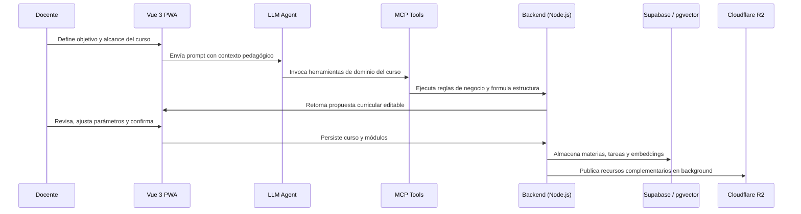
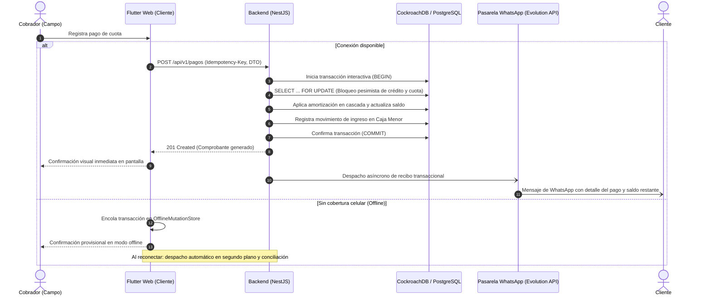

<div align="center">

<h1>Jesús Cueto | Software Engineer & Arquitectura Web</h1>

<p>
  Ingeniero de software enfocado en productos de alto impacto: arquitecturas limpias, backend transaccional de alta concurrencia, interfaces web reactivas, algoritmos de optimización logística e integración de LLMs con bases de datos mediante Model Context Protocol (MCP) y RAG.
</p>

<p>
  
  
  
  
  
</p>

<table>
  <tr>
    <td align="center"><strong>Arquitectura</strong><br>Monorepos, modularidad, bajo acoplamiento, DTOs y contratos tipados</td>
    <td align="center"><strong>Sistemas Transaccionales</strong><br>Concurrencia con bloqueo pesimista, ventanas de idempotencia y resiliencia offline</td>
    <td align="center"><strong>IA & Agentes</strong><br>Servidores MCP, asistentes con contexto RAG y flujos Human-in-the-Loop</td>
    <td align="center"><strong>Cloud & DevOps</strong><br>Contenedores Docker, CI/CD con GitHub Actions, Cloudflare Workers y Railway</td>
  </tr>
</table>

</div>

## GitHub Stats

<div align="center">
  <table>
    <tr>
      <td>
        <a
          href="https://github.com/JesusC1755"
          target="_blank"
          rel="noopener noreferrer"
          aria-label="Ver racha de contribuciones de Jesús Cueto"
        >
          
        </a>
      </td>
    </tr>
    <tr>
      <td>
        <a
          href="https://github.com/JesusC1755?tab=repositories"
          target="_blank"
          rel="noopener noreferrer"
          aria-label="Ver lenguajes más usados de Jesús Cueto"
        >
          
        </a>
      </td>
    </tr>
  </table>
</div>

## Perfil técnico

Egresado de Ingeniería de Sistemas en proceso de grado en la **Universidad de La Guajira**, con trayectoria en diseño y desarrollo de software full stack. Mi experiencia abarca desde el modelado relacional estricto y la orquestación de sistemas transaccionales hasta la construcción de herramientas asistidas por inteligencia artificial (RAG, Model Context Protocol) para resolver casos de negocio reales.

El enfoque técnico de mis desarrollos prioriza:
* **Integridad transaccional y concurrencia**: Protección de estados críticos de datos mediante bloqueos pesimistas, claves de idempotencia y trazabilidad de eventos.
* **Separación de responsabilidades**: Arquitecturas modulares basadas en contratos formales (DTOs, esquemas tipados) que aíslan la lógica de dominio de los proveedores de infraestructura.
* **Resiliencia en cliente**: Implementación de arquitecturas reactivas con tolerancia a desconexión mediante colas de mutaciones offline y sincronización en segundo plano.

---

## Proyectos destacados (Colaboraciones)

<table>
  <tr>
    <td width="50%" valign="top">
      <p><strong><font size="4">01. CourseV</font></strong></p>
      <p><strong>Plataforma educativa full stack con IA generativa, RAG, Model Context Protocol (MCP) y asistencia docente interactiva.</strong></p>
      <p>
        Solución integral para diseñar, estructurar y gestionar cursos, tareas y contenidos académicos. Conecta modelos de lenguaje con la base de conocimiento y el dominio de la plataforma para automatizar la labor pedagógica sin perder el control humano.
      </p>
      <p>
        <strong>Especialidad:</strong> Model Context Protocol (MCP), RAG, LLMs, Vue 3, TypeScript, PWA, Node.js, Express, Socket.io, Supabase, PostgreSQL (pgvector) y Cloudflare R2.
      </p>
    </td>
    <td width="50%" valign="top">
      <p><strong><font size="4">02. Cobro</font></strong></p>
      <p><strong>Monorepo fintech para gestión de créditos, tesorería de caja menor y optimización logística de cobranza en campo.</strong></p>
      <p>
        Sistema empresarial distribuido que orquesta desembolsos, pagos transaccionales con bloqueo pesimista, ruteo georreferenciado con Dijkstra, pasarela de mensajería WhatsApp y cliente web con soporte offline.
      </p>
      <p>
        <strong>Especialidad:</strong> NestJS, TypeScript, Prisma ORM, CockroachDB Cloud, PostgreSQL 15, Flutter Web, Dart, Next.js 19, OSRM, Evolution API y Docker Compose.
      </p>
    </td>
  </tr>
</table>

---

## Proyecto 01: CourseV

CourseV es una plataforma educativa creada para modernizar el aprendizaje digital y reducir la carga operativa docente mediante agentes inteligentes. Integra una Progressive Web App (PWA) reactiva en Vue 3 con un backend modular en Node.js/Express y servicios estandarizados de IA.

El valor central del sistema reside en conectar agentes LLM con herramientas de dominio autorizadas mediante el estándar **Model Context Protocol (MCP)**, garantizando que el asistente opere sobre el contexto curricular real y genere planes de estudio editables bajo un flujo *Human-in-the-loop*.

<p align="center">
  <a href="https://github.com/Jesuh02/MCP-backendDeploy" target="_blank" rel="noopener noreferrer">📦 Repositorio Backend (MCP)</a>
  &nbsp;&bull;&nbsp;
  <a href="https://github.com/Jesuh02/coursev_web_frontend" target="_blank" rel="noopener noreferrer">💻 Repositorio Frontend (Vue 3)</a>
</p>

### Arquitectura y decisiones técnicas

| Decisión técnica | Justificación e impacto |
| :--- | :--- |
| **Model Context Protocol (MCP)** | Desacoplamiento de herramientas de IA: permite al agente interactuar con el modelo de datos de cursos y tareas sin enlazar la lógica al proveedor del LLM. |
| **RAG sobre base vectorial** | Consultas contextualizadas sobre material de estudio y rúbricas almacenadas en **PostgreSQL con pgvector**, reduciendo alucinaciones en respuestas a estudiantes. |
| **Arquitectura de frontend modular** | Organización *feature-driven* en Vue 3 con Pinia para un flujo de estado reactivo y rutas protegidas con validación de roles y permisos. |
| **Generación asíncrona de recursos** | Despacho fuera del hilo principal para la creación de guías en Word/PDF, miniaturas y materiales multimedia almacenados en Cloudflare R2. |
| **Validación de contratos en API** | Esquemas Joi en los bordes de entrada para sanitizar payloads antes de invocar casos de uso o herramientas MCP. |

### Flujo de creación curricular con IA



---

## Proyecto 02: Cobro (Sistema de Cobranza & Cartera)

**Cobro** es una plataforma fintech integral diseñada para digitalizar, optimizar y blindar la gestión operativa de microcréditos y cobranza territorial (cartera puerta a puerta). Estructurado como un **monorepo distribuido**, el sistema centraliza la administración de tesorería y caja menor, la amortización automática de créditos, la logística de ruteo georreferenciado diario y la emisión instantánea de comprobantes transaccionales a costo cero.

Su diseño arquitectónico aborda de raíz los riesgos críticos de la cobranza en campo: previene duplicidades mediante **bloqueos pesimistas** e **idempotencia**, garantiza continuidad operativa en zonas sin conectividad mediante una **cola de mutaciones offline** en el cliente, y opera sobre un motor relacional tolerante a fallos desplegado en **CockroachDB Cloud** y **PostgreSQL 15**.

<p align="center">
  <a href="https://github.com/Jesuh02/cobro" target="_blank" rel="noopener noreferrer">📦 Repositorio Monorepo (Jesuh02/cobro)</a>
</p>

### Estructura del Monorepo

```
cobro/
├── backend/            # API REST modular en NestJS, TypeScript, Prisma ORM y arquitectura transaccional
├── frontend/           # Cliente Flutter Web / Dart con soporte offline y UI neomórfica/claymórfica
├── Landing_cobro/      # Portal comercial en Next.js 19, Tailwind CSS v4 y shaders 3D WebGL (Three.js)
├── docker/whatsapp/    # Pasarela de mensajería independiente con Evolution API v2 (Baileys WebSocket)
└── .github/workflows/  # Pipeline CI/CD atómico hacia Cloudflare Workers Static Assets y Railway
```

### Arquitectura y decisiones técnicas

| Decisión técnica | Justificación e impacto |
| :--- | :--- |
| **Bloqueo Pesimista (`FOR UPDATE`) & Idempotencia** | Recaudo de cuotas protegido a nivel de fila (`SELECT ... FOR UPDATE`) junto a una ventana de idempotencia de 30 segundos. Elimina pagos duplicados y colisiones por reintentos ante latencia en redes celulares móviles. |
| **Motor Híbrido: CockroachDB Cloud & PostgreSQL 15** | Operación en producción sobre **CockroachDB Cloud** (ANSI SQL distribuido con alta resiliencia) y **PostgreSQL 15** en Docker local. Esquema unificado bajo 24 entidades `tbl_*`, UUIDs nativos, 16 tipos ENUM y restricciones `CHECK` inyectadas en seed para integridad de datos. |
| **Resiliencia Offline en Cliente Flutter Web** | Implementación de `OfflineMutationQueue` y almacenamiento local defensivo. Permite a los cobradores registrar pagos y clientes en zonas rurales o puntos ciegos de conectividad, sincronizando y conciliando en segundo plano al recuperar señal. |
| **Optimización Logística de Rutas (Dijkstra + OSRM)** | Georreferenciación GPS de clientes, mapeo interactivo con FlutterMap y cálculo en tiempo real del orden óptimo de visitas con el algoritmo de Dijkstra y OSRM, minimizando tiempos de traslado y costos de transporte. |
| **Control Contable y Arqueo Diario de Caja Menor** | Validación estricta de saldo disponible antes de desembolsos o gastos operativos, garantizando en tiempo real la ecuación contable: `PRESUPUESTO = CAJA MENOR + RECAUDADO - CRÉDITOS - GASTOS`. |
| **Pasarela WhatsApp Desacoplada (Evolution API / Baileys)** | Emisión de comprobantes inmediatos al cliente vía WebSocket nativo a costo $0 por mensaje y consumo ligero (~140 MB RAM), con soporte desacoplado para conector oficial Meta Cloud API (YCloud) y auditoría en `tbl_notificaciones`. |
| **Despliegue Atómico en Cloudflare Workers & Railway** | Pipeline en GitHub Actions que compila Flutter Web (`/app/`) y la landing Next.js (`/`), desplegándolos como recursos estáticos en Cloudflare Workers Static Assets, mientras el backend transaccional escala en Railway. |
| **Entorno Docker Plug & Play** | Orquestación local en un solo comando (`docker compose up -d --build`) que levanta PostgreSQL 15, la API NestJS (con sincronización de esquema y seed de catálogos) y el cliente Flutter Web servido sobre Nginx. |

### Flujo transaccional de recaudo en ruta



---

<div align="center">
  <p>
    <strong>Jesús Cueto</strong> — Software Engineer especializado en arquitecturas transaccionales, modularidad y sistemas distribuidos.
  </p>
  <p>
    <a href="https://github.com/JesusC1755" target="_blank" rel="noopener noreferrer">
      
    </a>
    <a href="mailto:jdcueto11@gmail.com" target="_blank" rel="noopener noreferrer">
      
    </a>
  </p>
</div>
